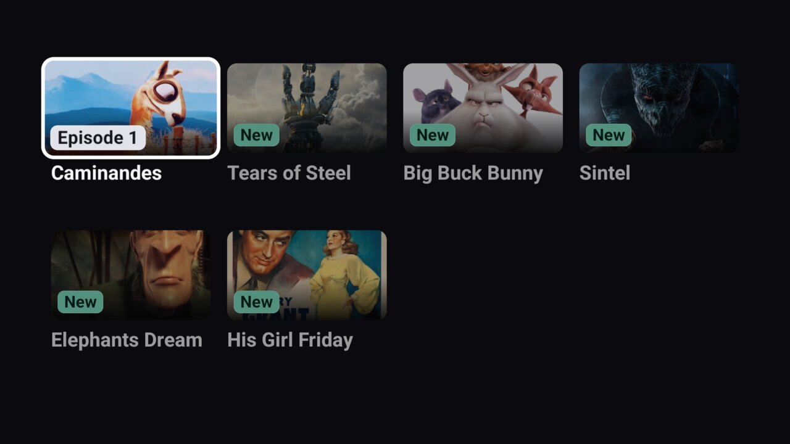
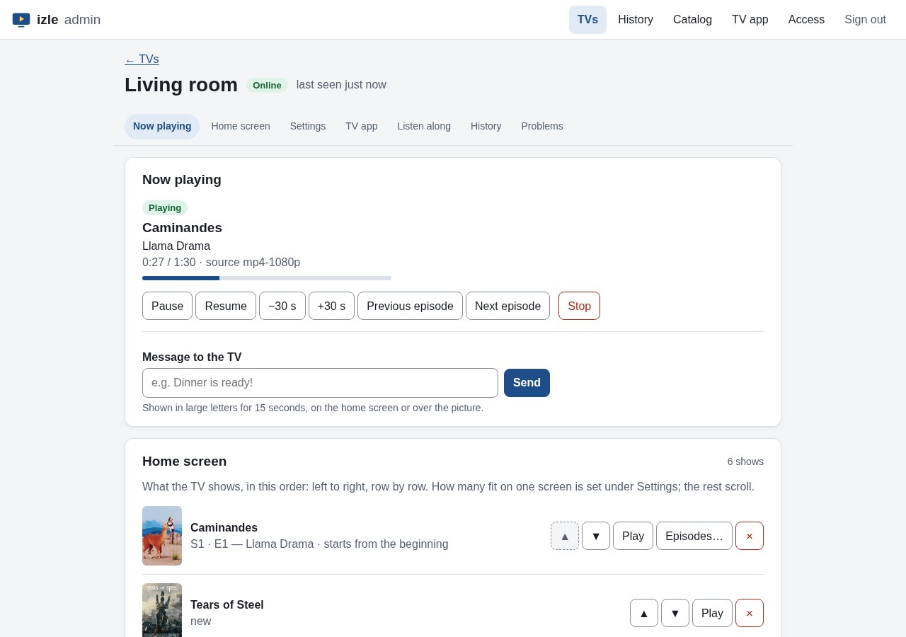
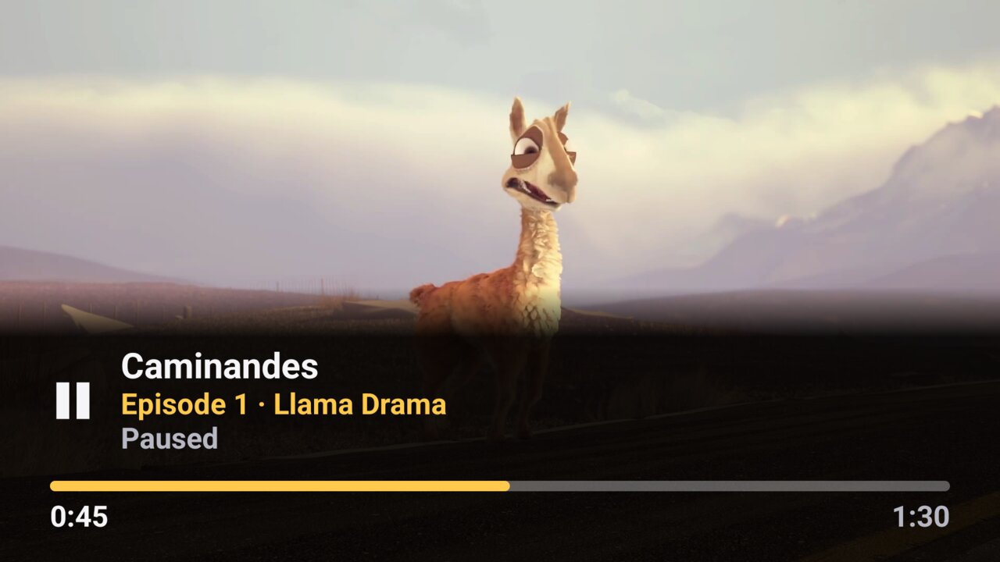
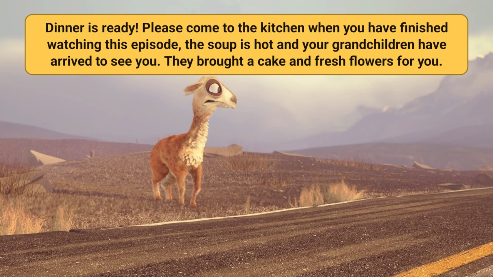

# izle

[](https://github.com/mickeiik/izle/actions/workflows/ci.yml)
[](https://github.com/mickeiik/izle/releases/latest)
[](LICENSE)

A senior-first Android TV player with a small self-hosted server. Project page: <https://mickeiik.github.io/izle/>

| The TV: one screen, OK plays | The owner's admin page |
|---|---|
|  |  |
|  |  |

izle is built for a viewer who only knows classic TV: switch on, pick a "channel", it plays. The TV shows one
grid of big show cards. OK plays the next unwatched episode (or resumes the half-watched one), episodes
advance on their own, and Back always returns to that single home screen. There is no browsing, no seasons
list, no settings in the viewer's path.

Everything else is done remotely by the owner from the server's admin page, on a phone or a computer:

- which shows are on each TV's home screen, in what order, and "continue from episode X"
- menu, audio and subtitle languages, autoplay when the TV starts
- what is playing right now: play, stop, pause, seek, skip episodes, and a short message in large letters on screen
- the problems a TV ran into, and a test of every episode's sources
- **listen along**: the phone plays another source of the episode the TV is showing (a dub in another language) in
  sync with the picture, with an adjustable offset and speed for releases that differ in timing
- the viewing history: what was watched when and how much of it, per TV and per title, with the owner's own marks
- access tokens with a scope, so the owner's own scripts or an AI agent can watch the TVs, play something, change a
  home screen, through the same API and a live event stream

The TV app always talks to the server; there is no standalone mode. The TV app is in English and Turkish.

**Status:** early development (see the [changelog](CHANGELOG.md)). Server, TV app, admin page and self-hosting
setup work; expect rough edges.

## Quick start (about 10 minutes)

Try izle with the included sample catalog of openly licensed films. You need a computer with Docker and Git, and an
Android TV (or Google TV) on the same network, or an Android TV emulator.

**1. Start the server** on the computer:

```bash
git clone https://github.com/mickeiik/izle.git && cd izle
docker build -t izle-server .
docker run -d --name izle --restart unless-stopped -p 8787:8787 -v izle-data:/var/lib/izle izle-server
curl -s http://localhost:8787/healthz          # {"ok":true}
```

**2. Open the admin page.** Print the admin token and sign in at `http://localhost:8787/admin/`:

```bash
docker exec izle izle-server admin-token --config /etc/izle/izle.json
```

To sign in from a phone instead, add `--link --base http://<computer's address>:8787` (for example
`http://192.168.1.10:8787`): it prints a sign-in link and a QR code to scan.

**3. Install the TV app.** Download `izle-tv-X.Y.Z-debug.apk` from the
[latest release](https://github.com/mickeiik/izle/releases/latest) and install it with
[adb](https://developer.android.com/tools/releases/platform-tools), after turning on USB or wireless debugging in
the TV's developer options:

```bash
adb connect <TV's address>:5555
adb install izle-tv-X.Y.Z-debug.apk
```

The debug APK is meant for trying izle: a later APK cannot be installed over it. For a TV you will keep using, take
`izle-tv-X.Y.Z.apk` instead. Other ways to install (without a computer, with a USB stick):
[self-hosting guide § 8](docs/deploy/self-hosting.md#8-install-the-tv-app). This first install is the only one
done at the TV: later releases reach it through the server (the admin page's **TV app** tab), and a TV on Android 12
or newer installs them by itself while idle.

**4. Pair the TV.** Start izle on the TV and enter the server's address, `http://<computer's address>:8787` (on the
emulator, keep the prefilled `http://10.0.2.2:8787`). The TV shows a 6-digit code: approve it on the admin page under
**TVs** and give the TV a name.

**5. Put shows on its home screen.** On the TV's page, add a few sample films under **Home screen**. The posters
appear on the TV at once; press OK on one and it plays. Try **Now playing** and **Message to the TV** from the admin
page while it does.

To remove everything afterwards: `docker rm -f izle && docker volume rm izle-data`, and uninstall the app.

## Your own content

izle ships no content of its own. The server reads a **catalog bundle**: a data-only directory (`bundle.json`,
`items.json` and the posters) that lists the shows, their episodes in play order and where each episode's video
is. The [sample catalog](sample-catalog/) is one. Videos are HLS, DASH or progressive files (MP4) at http(s) URLs.

- How a bundle is built: [catalog bundle contract](docs/spec/catalog-bundle-v1.md); check one with
  `npx izle-validate <dir>` (`--probe` also checks that every video answers).
- Streams that need resolving at play time (signed, expiring URLs, a required `Referer`): write a
  [resolver module](docs/spec/resolver-module-v1.md). A runnable [example module](server/examples/resolver-example/README.md)
  comes with a local stand-in streaming site.

Streams that need upstream request headers or come as playlist text are served to the TV through the server's media
proxy, so those headers and the upstream URLs never reach the TV.

## Running it for real

Each [release](https://github.com/mickeiik/izle/releases) has the server as one dependency-free package
(`izle-server-X.Y.Z.tgz`, Node.js ≥ 22.13) and the TV app as an APK. The [self-hosting guide](docs/deploy/self-hosting.md)
covers installing the server as a systemd service or with Docker, HTTPS with Caddy for TVs outside your home, your
own catalog and resolver module, backups and updates, installing the app on a TV, and troubleshooting.

Security problems are reported privately: [SECURITY.md](SECURITY.md).

## Development

Requirements: Node.js ≥ 22.13 and npm; for the TV app a JDK 21+ and the Android SDK.

```bash
npm ci && npm test
npm run -w server dev -- --config server/izle.dev.json            # sample catalog on :8787, state in server/data/
npm run -s -w server dev -- admin-token --config server/izle.dev.json   # prints the admin token
```

Every command (tests, typecheck, packaging, resolver check, the Android emulator loop) is listed in
[AGENTS.md](AGENTS.md#commands); [Try the API with curl](docs/try-the-api.md) walks through pairing a TV and playing
an episode by hand. Debug builds of the TV app prefill the emulator's address of the host's server; on the TV, the
remote's Menu key or holding OK opens the [hidden menu](docs/ux/senior-tv.md#hidden-menu). Making releases:
[docs/releasing.md](docs/releasing.md).

| Path | What |
|---|---|
| `contract/` | `@izle/contract` — bundle types, JSON Schema, validator, `izle-validate` CLI |
| `server/` | `@izle/server` — Hono + `node:sqlite` server: pairing, TV and admin APIs, live events, resolver modules, media proxy, admin page (`server/admin/`) |
| `server/examples/resolver-example/` | example resolver module with a local stand-in upstream and catalog |
| `sample-catalog/` | sample bundle of openly licensed content |
| `android/` | Android TV app (Kotlin, Compose for TV, Media3) |
| `scripts/` | release tooling: server package build (`pack-server.mjs`) and smoke test, version bump/check |
| `Dockerfile` | container image of the server package |
| `docs/` | specs ([catalog bundle](docs/spec/catalog-bundle-v1.md), [resolver module](docs/spec/resolver-module-v1.md), [server API](docs/spec/server-api-v1.md)), [TV UX](docs/ux/senior-tv.md), [self-hosting](docs/deploy/self-hosting.md), [releasing](docs/releasing.md), [decision log](docs/decisions.md) |

## License

[MIT](LICENSE). Sample-catalog media and posters keep their own licenses; see
[`sample-catalog/NOTICE.md`](sample-catalog/NOTICE.md). The screenshots show sample-catalog films and generated test
media.
