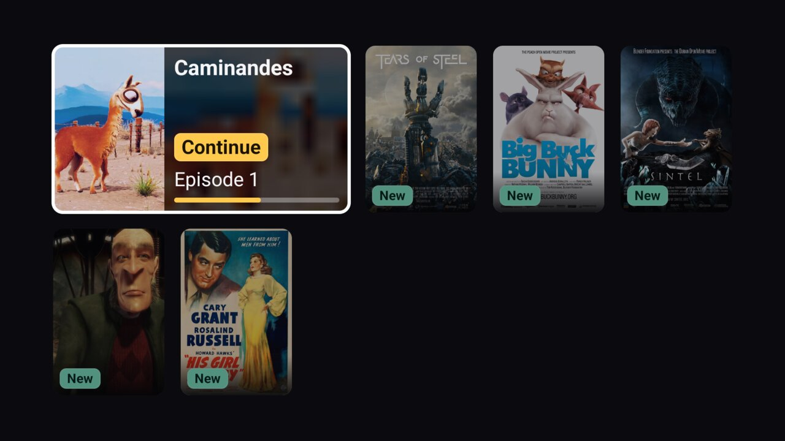
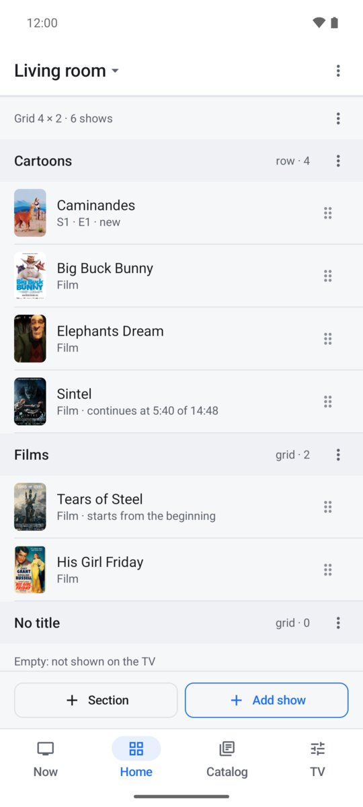
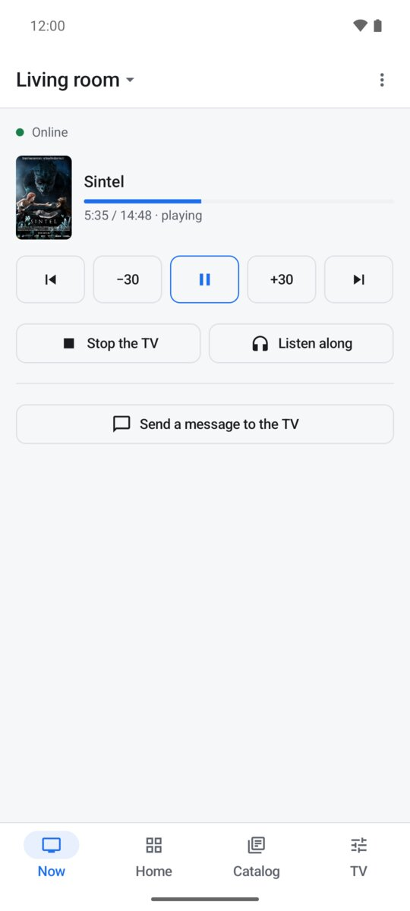
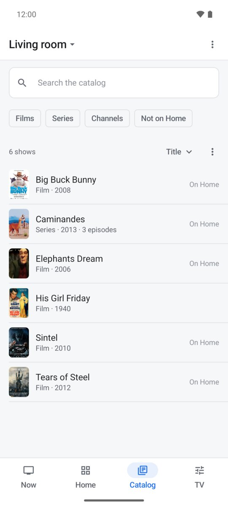
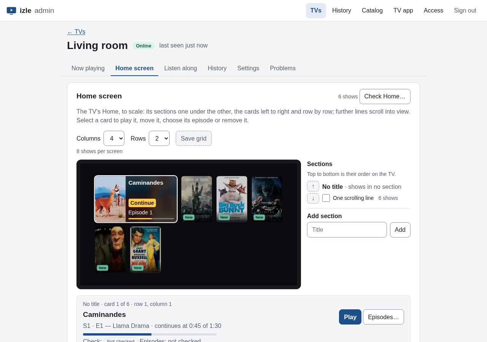
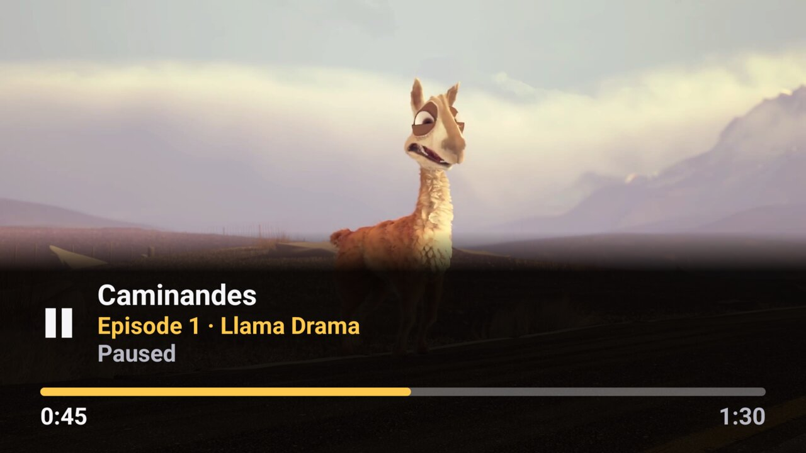
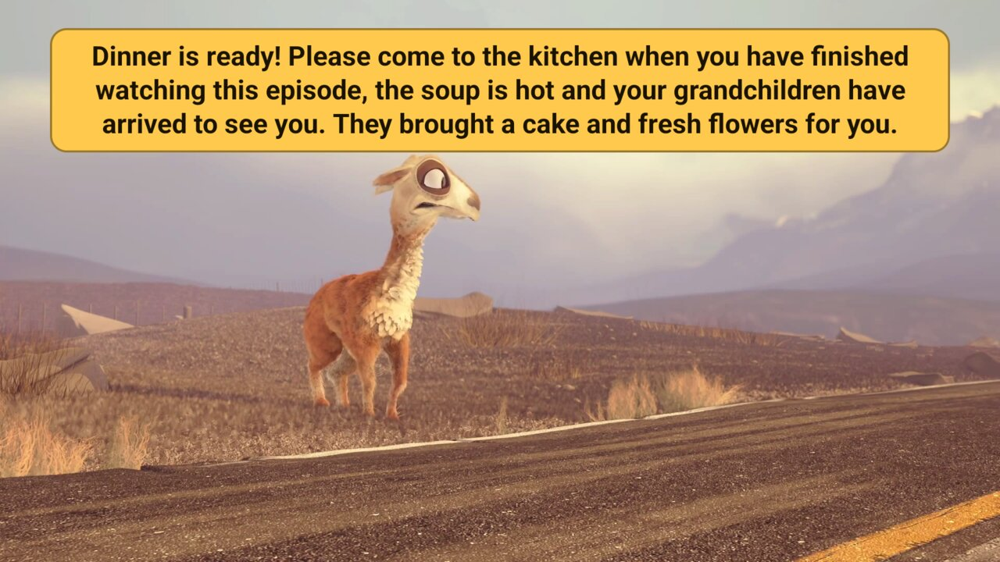

# izle

[](https://github.com/mickeiik/izle/actions/workflows/ci.yml)
[](https://github.com/mickeiik/izle/releases/latest)
[](LICENSE)

A senior-first Android TV player, run from your phone and a small self-hosted server. Project page:
<https://mickeiik.github.io/izle/>

| The TV: one screen, OK plays | You: izle companion on your phone |
|---|---|
|  |  |

**Status:** early development (see the [changelog](CHANGELOG.md)). The server, the TV app, the phone app, the admin
page and the self-hosting setup work; expect rough edges.

## How it works

**The TV.** izle is built for a viewer who only knows classic TV: switch on, pick a "channel", it plays. The TV shows
one grid of big cards: shows and live channels. OK plays the next unwatched episode (or resumes the half-watched one)
or a channel at its live edge. Episodes advance on their own, CH+/CH− switch between channels, and Back always returns
to that single home screen. There is no browsing, no seasons list, no settings in the viewer's path. When something
goes wrong, the TV says so in large letters and goes back to Home by itself. The app is in English and Turkish.

**You.** Everything else is done remotely, by you: with **izle companion**, the Android app for your phone, or with
the server's admin page in any browser, on a phone or a computer. The phone app has what you need day to day; the
admin page has everything, the viewing history and access tokens included.

**Your server.** izle-server runs on a machine that is always on (a home server, a NAS, a Raspberry Pi, a small VPS).
It reads your **catalog bundle**, a folder of JSON and posters that says what the shows are and where their videos
are, and, if your streams need it, your own **resolver module**. The TV and the phone talk only to it; there is no
account and no cloud.

## What you can do from your phone

<table>
<tr>
<td></td>
<td></td>
</tr>
</table>

- **Home and sections.** Choose which shows and channels are on each TV's Home, in titled sections or one scrolling
  line, in what order (drag them), how big the grid is (3–10 columns, 1–4 rows), and "continue from episode X". The
  Catalog tab searches the whole catalog, shows what each new catalog build added, and adds a show or plays it on the
  TV.
- **App cards and izle as the home screen.** A card on Home can open another app installed on the TV (a weather app,
  for example). On the TV, izle can also be made its home screen, so that HOME and switching the TV on open
  izle; this is optional, and a TV whose own home screen claims HOME (Google TV does) keeps it unless that one is
  turned off with adb.
- **Remote and messages.** See what is playing; pause, seek 30 s, skip episodes or channels, or stop it, from
  anywhere. Send a short message that the TV shows in large letters for 15 s, 1 min or 2 min.
- **Problems and source checks.** Each TV's problems in words (show, episode, source, when), and a check of what OK
  plays on Home, or of every episode, along the TV's own path to the media.
- **Listen along.** The phone plays another source of the episode the TV is showing (a dub in another language, for
  example) in sync with the picture, in your earphones. When two releases differ in timing, tap **Mark on TV** when
  you see a moment and **Mark on phone** when you hear it, and pick the speed (PAL vs film). The phone app keeps
  playing with the screen off, and can play a link you found in its own browser.
- **Viewing history.** What was watched when and how much of it, per TV and per title, with your own marks (on the
  admin page). Each TV's activity, live, is on the phone too.
- **Your own scripts and AI agents.** Access tokens with a scope (`read`, `control`, `manage`) let a script, a
  home-automation hook or an AI agent watch the TVs, play something or change a Home, through the same
  [API](docs/spec/server-api-v1.md#remote-management) and a live event stream.

The phone connects from the TV: no token to copy. On the admin page, the same TV looks like this:



| On the TV: the player | On the TV: a message from you |
|---|---|
|  |  |

## Quick start (about 10 minutes)

Try izle with the included sample catalog of openly licensed films. You need a computer with Docker and Git, an
Android TV (or Google TV) on the same network, or an Android TV emulator, and for step 5 an Android phone.

**1. Start the server** on the computer, then print the admin token and sign in at `http://localhost:8787/admin/`
(from a phone: add `--link --base http://<computer's address>:8787` for a sign-in link and QR code):

```bash
git clone https://github.com/mickeiik/izle.git && cd izle
docker build -t izle-server .
docker run -d --name izle --restart unless-stopped -p 8787:8787 -v izle-data:/var/lib/izle izle-server
docker exec izle izle-server admin-token --config /etc/izle/izle.json
```

**2. Install the TV app.** Download `izle-tv-X.Y.Z-debug.apk` from the
[latest release](https://github.com/mickeiik/izle/releases/latest) and install it with
[adb](https://developer.android.com/tools/releases/platform-tools), after turning on USB or wireless debugging in
the TV's developer options:

```bash
adb connect <TV's address>:5555
adb install izle-tv-X.Y.Z-debug.apk
```

The debug APK is for trying izle: a later APK cannot be installed over it. For a TV you will keep using, take
`izle-tv-X.Y.Z.apk`; other ways to install, and how later releases reach the TV through the server:
[self-hosting guide § 8](docs/deploy/self-hosting.md#8-install-the-tv-app).

**3. Pair the TV.** Start izle on the TV and enter `http://<computer's address>:8787` (on the emulator, keep the
prefilled `http://10.0.2.2:8787`). Approve the 6-digit code it shows on the admin page under **TVs**.

**4. Put shows on its home screen.** On the TV's page, add a few sample films under **Home screen**; they appear on
the TV at once. Press OK on one, and try **Now playing** and **Message to the TV** from the admin page while it plays.

**5. Connect your phone.** Install `izle-companion-X.Y.Z-debug.apk` from the same release on your Android phone
(Android 7 or newer; allow your browser or file manager to install unknown apps). On the TV, hold OK (or press the
Menu key) to open the hidden menu, then **Settings → Connect a phone**: the TV shows a QR code and a 6-digit code for
5 minutes. Scan the QR code with the phone's camera, or open izle companion and enter the server's address and the
code. The phone opens that TV's page: **Now**, **Home**, **Catalog** and **TV**.

To remove everything afterwards: `docker rm -f izle && docker volume rm izle-data`, and uninstall both apps.

## Your own content

izle ships no content of its own. The server reads a **catalog bundle**: a data-only directory (`bundle.json`,
`items.json` and the posters) that lists the shows (their episodes in play order) and the live channels, and where
each video or stream is. The [sample catalog](sample-catalog/) is one. Videos are HLS, DASH or progressive files
(MP4) at http(s) URLs; a channel is a live HLS or DASH playlist or a raw MPEG-TS stream.

- How a bundle is built: [catalog bundle contract](docs/spec/catalog-bundle-v1.md); check one with
  `npx izle-validate <dir>` (`--probe` also checks that every video answers).
- Streams that need resolving at play time (signed, expiring URLs, a required `Referer`): write a
  [resolver module](docs/spec/resolver-module-v1.md); a runnable [example](server/examples/resolver-example/README.md)
  comes with a local stand-in streaming site. Streams that need upstream headers or come as playlist text reach the TV
  through the server's media proxy, so those headers and the upstream URLs never do.

## Running it for real

Each [release](https://github.com/mickeiik/izle/releases) has the server as one dependency-free package
(`izle-server-X.Y.Z.tgz`, Node.js ≥ 22.13), the TV app and the phone app as APKs. The
[self-hosting guide](docs/deploy/self-hosting.md) covers systemd or Docker, HTTPS with Caddy for TVs outside your
home, your own catalog and resolver module, backups and updates, installing the apps, and troubleshooting. The server
keeps the TVs' app up to date; the phone app is installed by hand. Security problems are reported privately:
[SECURITY.md](SECURITY.md).

## Documentation

| For | Read |
|---|---|
| Owners | [Self-hosting guide](docs/deploy/self-hosting.md) · [the TV](docs/ux/senior-tv.md) · [izle companion](docs/ux/companion.md) ([Home](docs/ux/companion-home.md), [Catalog](docs/ux/companion-catalog.md), [TV tab](docs/ux/companion-tv.md)) · [a TV's Home on the admin page](docs/ux/admin-home.md) · [changelog](CHANGELOG.md) · [security](SECURITY.md) |
| Catalog authors | [Catalog bundle contract](docs/spec/catalog-bundle-v1.md) · validator: `npx izle-validate <dir>` ([contract/](contract/)) · [resolver module](docs/spec/resolver-module-v1.md) and its [example](server/examples/resolver-example/README.md) |
| Developers | [Server API](docs/spec/server-api-v1.md) · [API tour with curl](docs/api-tour.md) · [AGENTS.md](AGENTS.md) · [releasing](docs/releasing.md) · [decision log](docs/decisions.md) |

## Development

Node.js ≥ 22.13 and npm (`npm ci && npm test`); for the Android apps a JDK 21+ and the Android SDK. Every command is
in [AGENTS.md](AGENTS.md#commands); a walk through the API with curl against the development server:
[docs/api-tour.md](docs/api-tour.md); making releases: [docs/releasing.md](docs/releasing.md).

| Path | What |
|---|---|
| `contract/` | `@izle/contract` — bundle types, JSON Schema, validator, `izle-validate` CLI |
| `server/` | `@izle/server` — Hono + `node:sqlite` server: pairing, TV and admin APIs, live events, resolver modules, media proxy, admin page (`server/admin/`) |
| `server/examples/resolver-example/` | example resolver module with a local stand-in upstream and catalog |
| `sample-catalog/` | sample bundle of openly licensed content |
| `android/core/` | shared Android library: API client and models, media engine, shared helpers |
| `android/app/` | the Android TV app (Kotlin, Compose for TV, Media3) |
| `android/companion/` | izle companion, the phone app (Kotlin, Compose, Media3) |
| `scripts/` | release tooling: server package build (`pack-server.mjs`) and smoke test, version bump/check |
| `site/` | the project page (static, no build step) |
| `Dockerfile` | container image of the server package |
| `docs/` | specs, UX rules, self-hosting, releasing, decision log (see [Documentation](#documentation)) |

## License

[MIT](LICENSE). Sample-catalog media and posters keep their own licenses; see
[`sample-catalog/NOTICE.md`](sample-catalog/NOTICE.md). The screenshots show sample-catalog films and generated test
media.
